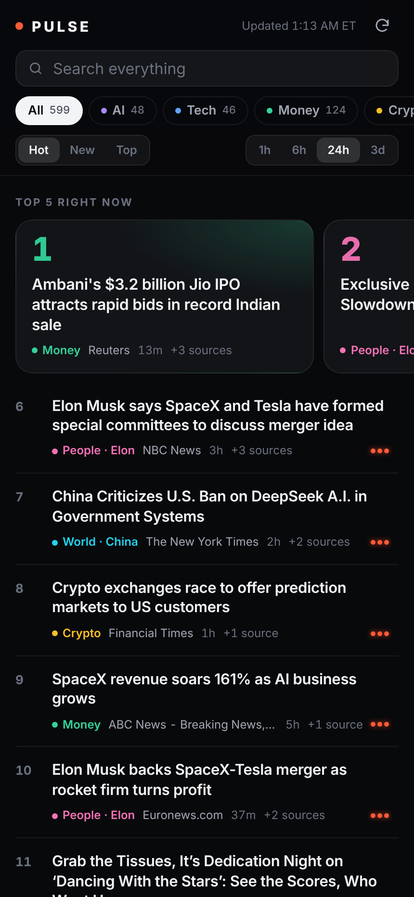

# PULSE

Your own world feed: AI, tech, money, crypto, people, world, health, science, culture, and hype, ranked by heat in one minimal app.

- **Runs entirely on GitHub, for free.** Every 15 minutes a GitHub Action fetches about 30 free public sources, ranks them, and republishes the site. Nothing runs on your phone or computer, and there are no API keys or paid services.
- **Installs like an app.** Open the site in Safari, tap Share, then Add to Home Screen.



## Setup (5 steps, about 10 minutes)

1. **Make a GitHub account** at [github.com/signup](https://github.com/signup). It's free.
2. **Create a new public repository** named `pulse` (click **+** at the top right, then **New repository**). Leave it empty. It must be **Public**: free GitHub Pages and unlimited Actions minutes require a public repo.
3. **Upload this folder.** On the new repo page, click **uploading an existing file** and drag in everything from this folder, including the hidden `.github` folder. Then click **Commit changes**.
   *(Or, if you use git: `git remote add origin https://github.com/YOUR_NAME/pulse.git && git push -u origin main`)*
   > On a Mac, press **Cmd + Shift + .** in Finder to show hidden folders like `.github`.
4. **Turn on Pages.** In the repo, go to **Settings → Pages → Build and deployment → Source** and choose **GitHub Actions**.
5. **Run it once.** Go to the **Actions** tab, click **Build & deploy PULSE**, then **Run workflow**. After about a minute your app is live at
   `https://YOUR_NAME.github.io/pulse/`. Open that link on your iPhone in Safari, tap **Share**, then **Add to Home Screen**.

From then on it refreshes itself every 15 minutes.

### Optional
- **Keep your email private.** The SEC requires automated clients to send a contact email. Set your own under **Settings → Secrets and variables → Actions → New repository secret** with the name `CONTACT_EMAIL`, then remove the default email from `build.py`.
- **Add or remove sources.** Edit the `SOURCES` table in `build.py`. Any Google News search is one line.

## How the ranking works

`heat = engagement × recency × coverage`

- **Engagement** is each item's percentile *within its own source*, so 500 Hacker News points and position #1 in Google News are on the same scale. Sources backed by real engagement (HN, Reddit, Reddit ticker mentions) are weighted a bit higher than plain search results.
- **Recency** has a half-life of 6 hours.
- **Coverage:** when several outlets run the same story, it's merged into one card ("+3 sources") and boosted.

Sorts: **Hot** uses heat, **New** is newest first, and **Top** is engagement × coverage regardless of age. The time filter covers 1h, 6h, 24h, or 3d.

## Run locally

```bash
python3 build.py                                     # writes site/data.json (~1-5 s)
cd site && python3 -m http.server 8780              # open http://localhost:8780
```

## Files

```
build.py                      fetch → normalize → dedupe → score → site/data.json (stdlib only)
site/index.html app.css app.js the app (no frameworks, ~20 KB)
site/sw.js                    offline app shell + last-known data
site/manifest.webmanifest     home-screen install
.github/workflows/build.yml   cron every 15 min → commit data → deploy Pages
```

The data comes from public feeds: Google News RSS, Hacker News, Hugging Face, Product Hunt, ApeWisdom, CoinGecko, SEC EDGAR, and Reddit (when Reddit allows it). Headlines link to the original publishers. Nothing here is financial advice.
